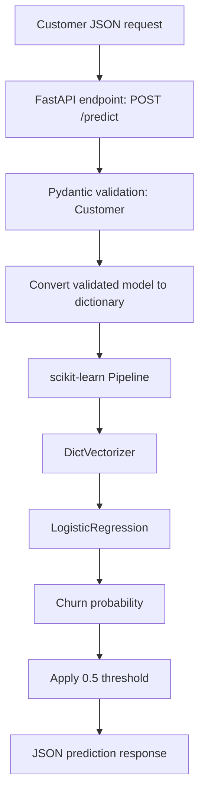

# Customer Churn Prediction API

A machine-learning project that predicts the likelihood of a telecom customer churning. The trained **scikit-learn Pipeline** is served through a **FastAPI** REST API, request data is validated with **Pydantic**, and the application is packaged with **Docker**.

<p align="left">
  
  
  
  
  
  
  
</p>

---

## Contents

- [Project overview](#project-overview)
- [How it works](#how-it-works)
- [Tech stack](#tech-stack)
- [Project structure](#project-structure)
- [Getting started](#getting-started)
- [Run the API](#run-the-api)
- [Try the prediction endpoint](#try-the-prediction-endpoint)
- [Run with Docker](#run-with-docker)
- [Model training](#model-training)
- [AWS deployment record](#aws-deployment-record)
- [Configuration and validation](#configuration-and-validation)
- [Limitations and security notes](#limitations-and-security-notes)

## Project overview

The API accepts customer information as JSON and returns:

| Field | Type | Description |
|---|---|---|
| `churn_probability` | `float` | The model's estimated probability that the customer will churn. |
| `churn` | `boolean` | The predicted class using a decision threshold of `0.5`. |

The prediction pipeline combines a `DictVectorizer` and a `LogisticRegression` classifier. The fitted pipeline is serialized to `model.bin` and loaded by the API when the application starts.

## How it works



1. A client sends customer data to `POST /predict`.
2. FastAPI validates the request against the Pydantic `Customer` model.
3. The validated object is converted to a Python dictionary.
4. The saved scikit-learn pipeline transforms the record and calculates the churn probability.
5. The API returns the probability and the predicted churn label.

## Tech stack

| Technology | Purpose |
|---|---|
| Python | Application and model code |
| pandas | Data loading and preparation in the training workflow |
| scikit-learn | Feature vectorization, pipeline, and classification |
| FastAPI | REST API framework |
| Pydantic | Request and response validation |
| Uvicorn | ASGI server for running the API |
| uv | Python version, dependency, and environment management |
| Docker | Containerization and reproducible runtime environment |
| AWS Elastic Beanstalk | Cloud deployment experiment |

## Project structure

```text
.
├── .ebextensions/
│   └── 01-port.config       # Elastic Beanstalk application port setting
├── Dockerfile               # Docker image instructions
├── model.bin                # Trained scikit-learn pipeline
├── predict.py               # FastAPI application and prediction endpoint
├── train.py                 # Model training and serialization workflow
├── marketing.py             # Example client/service script
├── ping.py                  # Minimal FastAPI connectivity example
├── pyproject.toml           # Project metadata and dependencies
├── uv.lock                  # Locked dependency versions
├── .python-version          # Python version used by the project
└── README.md
```

> **Note:** The training script may require the original training dataset. The dataset is not included in this repository; make sure it is available at the path expected by `train.py` before retraining.

## Getting started

### Requirements

- Python version compatible with `.python-version` and `requires-python` in `pyproject.toml` (currently Python 3.14 or newer).
- [uv](https://docs.astral.sh/uv/)
- Docker (only if you plan to run the containerized version)

### 1. Clone the repository

```bash
git clone <YOUR_REPOSITORY_URL>
cd <YOUR_REPOSITORY_FOLDER>
```

Replace the placeholders with your GitHub repository URL and local folder name.

### 2. Install dependencies

```bash
uv sync --no-install-project
```

This installs the dependencies recorded in `uv.lock` without installing the repository itself as a Python package.

## Run the API

Start the development server from the project root:

```bash
uv run uvicorn predict:app --host 0.0.0.0 --port 9696 --reload
```

Open the interactive Swagger UI:

- **API documentation:** <http://localhost:9696/docs>
- **Alternative documentation:** <http://localhost:9696/redoc>

Stop the server with `Ctrl+C`.

## Try the prediction endpoint

### Endpoint

```http
POST /predict
Content-Type: application/json
```

<details>
<summary>Expand example customer request</summary>

```json
{
  "gender": "male",
  "seniorcitizen": 0,
  "partner": "no",
  "dependents": "yes",
  "phoneservice": "no",
  "multiplelines": "no_phone_service",
  "internetservice": "dsl",
  "onlinesecurity": "no",
  "onlinebackup": "yes",
  "deviceprotection": "no",
  "techsupport": "no",
  "streamingtv": "no",
  "streamingmovies": "no",
  "contract": "month-to-month",
  "paperlessbilling": "yes",
  "paymentmethod": "electronic_check",
  "tenure": 6,
  "monthlycharges": 29.85,
  "totalcharges": 129.85
}
```

</details>

### Example response

```json
{
  "churn_probability": 0.5415578757452986,
  "churn": true
}
```

The probability above is an example from a successful deployment test. Actual predictions depend on the input record and the trained model.

The classification rule is:

- `churn = true` when `churn_probability >= 0.5`.
- `churn = false` when `churn_probability < 0.5`.

### Send a request with curl

With the API running locally, save the example request as `customer.json` and run:

```bash
curl -X POST "http://localhost:9696/predict" \
  -H "Content-Type: application/json" \
  --data @customer.json
```

## Run with Docker

The Docker image contains the Python runtime, project dependencies, API code, and trained model.

### 1. Build the image

Run this command from the directory containing the `Dockerfile`:

```bash
docker build -t churn-prediction .
```

### 2. Start the container

```bash
docker run --rm -p 9696:9696 churn-prediction
```

Then open <http://localhost:9696/docs> to test the API.

To stop the container, press `Ctrl+C`. The `--rm` option removes the stopped container automatically; the Docker image remains available locally.

## Model training

The training workflow is in `train.py`. To retrain the model and regenerate `model.bin`, run:

```bash
uv run python train.py
```

Before running the script:

1. Make sure the training dataset is available at the location expected by `train.py`.
2. Check that all training-time dependencies are listed in `pyproject.toml` and installed in the uv environment.
3. Run the script from the project root so relative file paths resolve as expected.

The API uses the saved pipeline in `model.bin`; retraining is not required to start the prediction service.

## AWS deployment record

The Dockerized FastAPI application was successfully deployed to **AWS Elastic Beanstalk** as a deployment exercise.

| Setting | Value |
|---|---|
| AWS service | Elastic Beanstalk |
| Region | `eu-north-1` (Europe — Stockholm) |
| Platform | Docker on 64-bit Amazon Linux 2023 |
| EC2 instance type | `t3.micro` |
| Application port | `9696` |
| Deployment result | Environment reached `Ready` with `Green` health |
| API verification | `POST /predict` returned a valid prediction |

<details>
<summary>Deployment outcome and cleanup details</summary>

- The environment reached `Ready` status with `Green` health.
- The public `POST /predict` endpoint returned a valid prediction during testing.
- The Elastic Beanstalk environment was terminated after testing.
- The associated application version and source ZIP were deleted from the project deployment path in S3.
- The EC2 instance was confirmed as `terminated`.

</details>

> **The AWS endpoint is no longer active.** Run the API locally or with Docker using the instructions above. The AWS deployment details are included as a record of the completed deployment exercise, not as a currently available demo.

## Configuration and validation

- Request fields and permitted categorical values are defined by the Pydantic `Customer` model in `predict.py`.
- The response schema is defined by `PredictResponse`.
- The classification threshold is currently fixed at `0.5`.
- Keep training and inference preprocessing consistent. The saved pipeline performs the feature transformation used for prediction.
- Dependency versions are tracked in `uv.lock` to make environment setup reproducible.

## Limitations and security notes

- This is an educational machine-learning deployment project, not a production-ready telecom decision system.
- The API does not currently implement authentication, authorization, rate limiting, or request logging controls.
- Do not submit real customer personal information to a publicly exposed instance without appropriate security and privacy controls.
- `model.bin` is a Pickle-based artifact. Only load model files from trusted sources; loading an untrusted Pickle file can execute arbitrary code.
- A probability is a model estimate, not a guarantee that a customer will churn.

---

<p align="center">
  Built as a hands-on machine-learning deployment project with Python, scikit-learn, FastAPI, Docker, and AWS.
</p>
